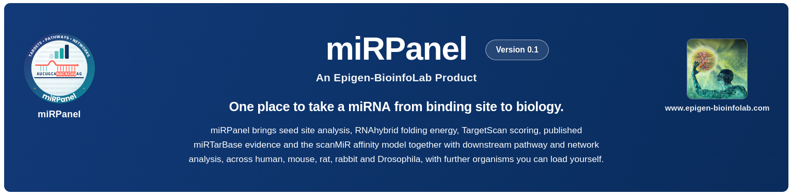
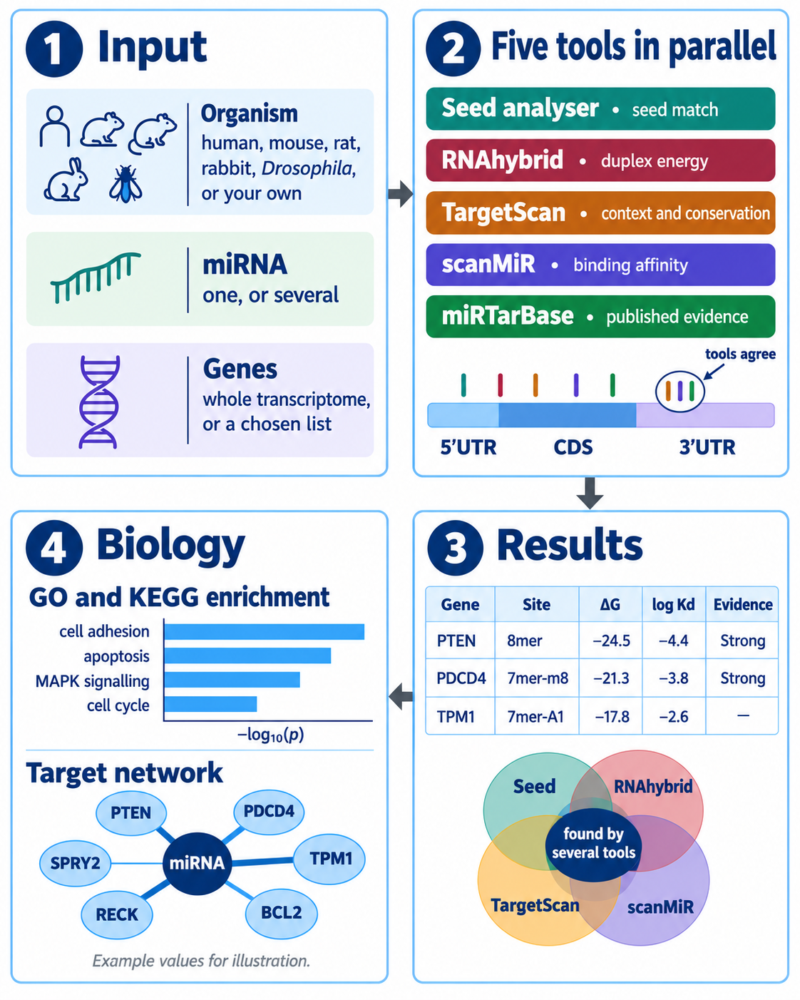
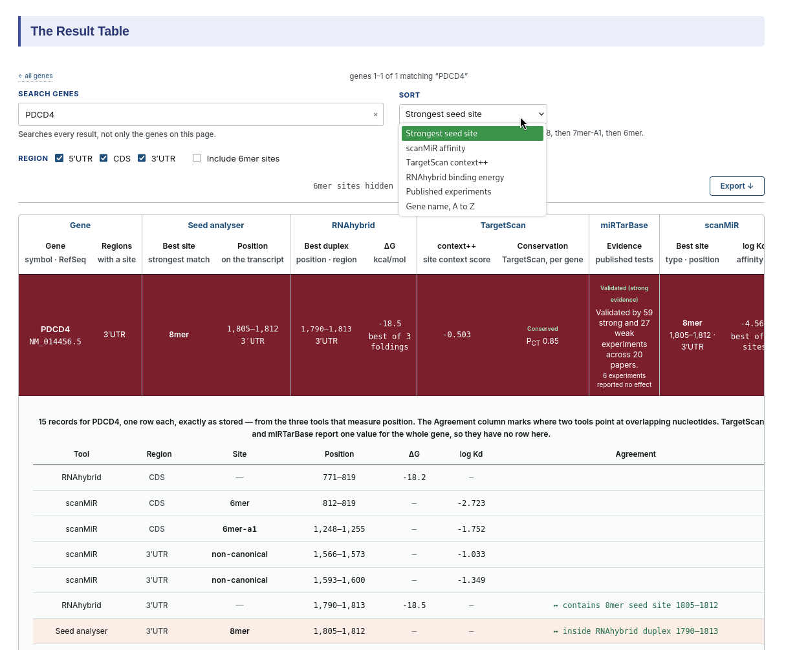
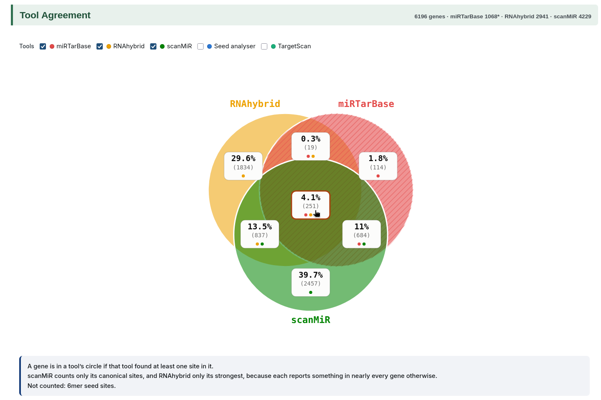
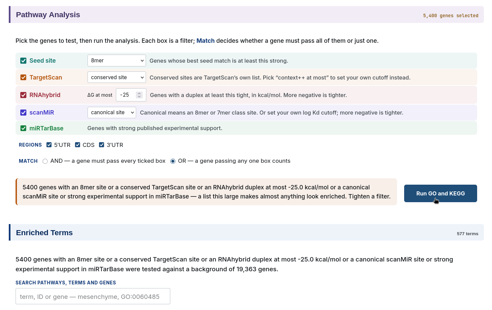
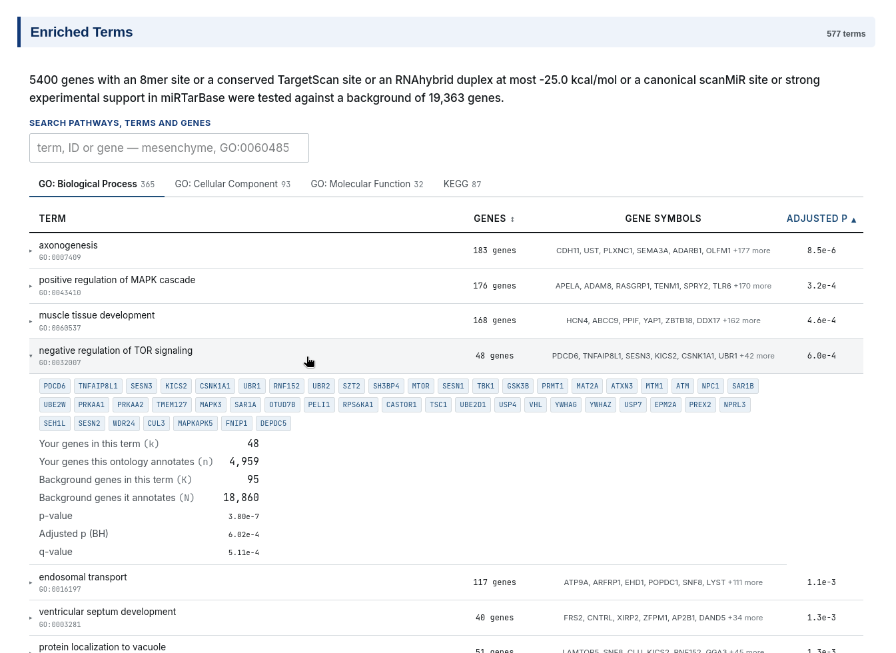
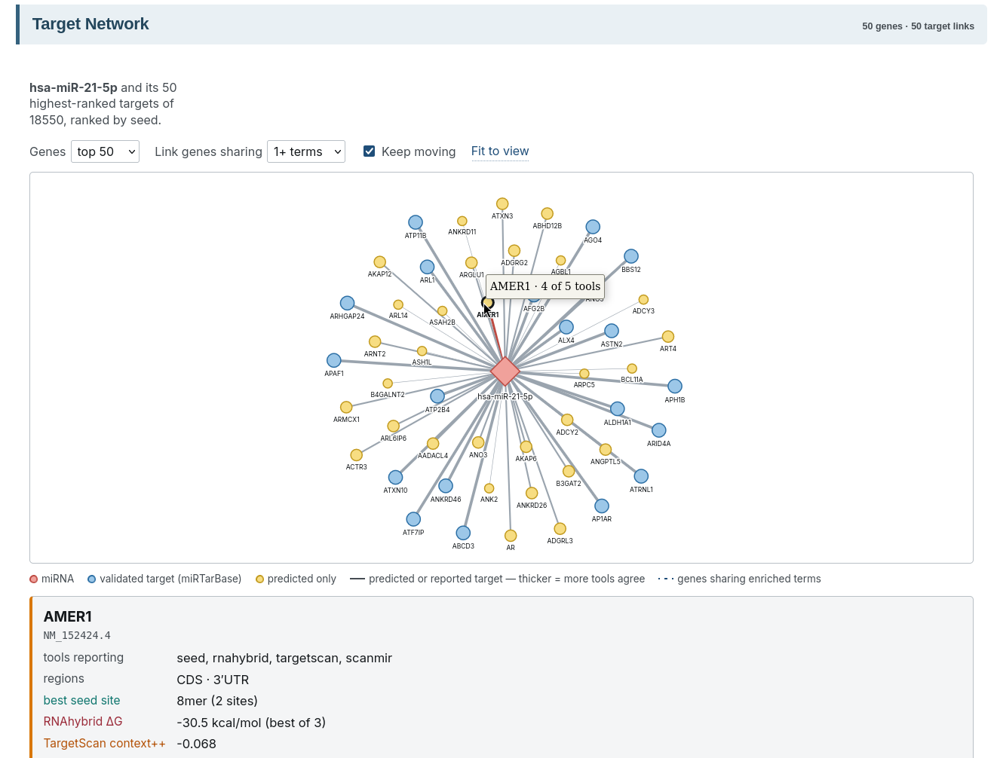
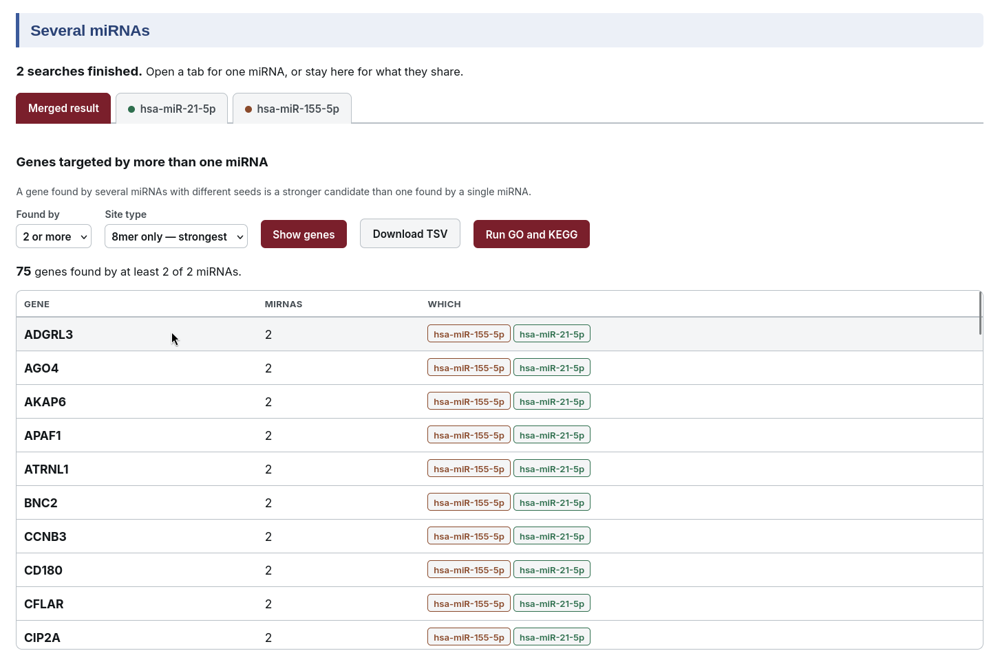

# miRPanel

**Integrated Platform for microRNA Target Prediction and Downstream Functional Analysis**


### Overview

Finding the targets of a microRNA usually means running several prediction tools one after another, each with its own input format, its own output and its own idea of what a good score looks like. The answers rarely agree, and reconciling them is left to the researcher.

miRPanel brings five established methods into one place. Choose an organism, enter one microRNA or a whole list of them, and miRPanel scans every transcript with all five tools in a single run, on the same sequences and the same coordinates. The results come back side by side, one row per gene.

From there, miRPanel answers the questions that matter next:

- **Which tools agree on an interaction** — at the level of the gene, and down to the individual site on the transcript.
- **Which genes are targeted by several of your miRNAs at once**, and by how many.
- **What those genes do together**, through GO and KEGG enrichment and an interactive target network.

A site found by several tools is a far stronger candidate than one with a single extreme value. miRPanel runs locally, in your browser. Your data never leaves your machine.

<p align="center"></p>

*Figure 1. The miRPanel workflow. Five prediction methods are run on the same transcriptome, their results are compared for agreement, and the genes they support are taken forward to GO and KEGG enrichment and a target network. Values shown are illustrative.*

### Features

#### Five tools, one run

| Tool | Basis | What it reports |
|---|---|---|
| Seed analyser | Exact complementarity to the miRNA seed (nucleotides 2–8) | Site type — 8mer, 7mer-m8, 7mer-A1, 6mer — and its position |
| RNAhybrid 2.1.2 | Minimum free energy of the miRNA–mRNA duplex | ΔG in kcal/mol |
| TargetScan v8.0 | Site context and conservation across species | context++ score and P<sub>CT</sub> |
| scanMiR 1.16.0 | Biochemical model trained on measured binding affinities | log K<sub>d</sub>, site class and position |
| miRTarBase 10.0 | Curated experimental evidence from the literature | Number and strength of published validations |

Each tool looks at targeting from a different angle — sequence, thermodynamics, conservation, measured affinity and experiment. Together they give a fuller picture than any one of them alone.

#### Five organisms, or your own

Built in: human, mouse, rat, rabbit and *Drosophila*, each with its full transcriptome ready to search.

Working with another species? Upload your own and miRPanel searches it the same way. You need two files from the same genome release:

1. **Transcript sequences** — a FASTA file of transcript (cDNA) sequences
2. **Annotation** — the matching GTF file, so miRPanel knows where the 5′UTR, CDS and 3′UTR lie in each transcript

The transcript IDs must be the same in both files. Downloading both from the same Ensembl release is the easiest way to make sure they match.

Your own organism is searched with the seed analyser, RNAhybrid and scanMiR. TargetScan and miRTarBase only cover the species they were built for.

#### From prediction to biology, in one place

- **Whole-transcriptome or targeted search.** Scan every gene, or only the genes you name.
- **Several miRNAs at once.** Search up to 20 miRNAs together and see which genes they share.
- **Binding map.** Every site from every tool drawn on the transcript, across 5′UTR, CDS and 3′UTR.
- **Site-level agreement.** Open any gene to see each individual site, with overlapping predictions from different tools marked.
- **Tool Agreement.** A Venn figure of which tools found which genes. Click any region to pull out exactly those genes.
- **Pathway Analysis.** GO and KEGG enrichment on any gene set you build, by rule or straight from an agreement region.
- **Target Network.** The miRNA and its top targets as an interactive network, weighted by how many tools agree.
- **Export everything** as TSV or Excel.
- **A built-in guide** on the page, explaining what every score means and how to read it.

### System Requirements

| Requirement | Details |
|---|---|
| Operating system | Linux (x86-64) |
| Memory | 8 GB RAM recommended |
| Disk space | ~4 GB |
| Download | 1.7 GB with Docker, 588 MB for the native install |

Docker images are built for x86-64.

### Installation

miRPanel can be installed in two ways. Docker is the simplest and fastest one: R, the Bioconductor packages, RNAhybrid and the reference database all arrive ready to run in a single download. The other one is native install that sets each component up directly on your system.

#### Option 1 — Docker (recommended)

**Step 1. Install Docker**

```bash
sudo apt update && sudo apt install -y docker.io
sudo usermod -aG docker $USER
```

Log out and log back in, so your account can use Docker.

**Step 2. Run miRPanel**

```bash
docker run -d --name mirpanel -p 8000:8000 ghcr.io/epigen-bioinfolab/mirpanel:latest
```

The first run downloads 1.7 GB. After that, it starts instantly.

**Step 3. Open it**

Go to http://localhost:8000 in your browser.

Everything miRPanel needs — R, the Bioconductor packages, RNAhybrid and the full reference database — is already inside the image.

| To | Run |
|---|---|
| Stop | `docker stop mirpanel` |
| Start again | `docker start mirpanel` |
| Remove | `docker rm -f mirpanel` |

Your results are kept inside the container. Stop and start keep them, but remove deletes them. Export anything you want to keep.

#### Option 2 — Native install

**Step 1. System packages**

```bash
sudo apt update
sudo apt install -y python3 python3-venv python3-pip rnahybrid sqlite3 curl git \
  build-essential cmake libcurl4-openssl-dev libssl-dev libxml2-dev \
  libfontconfig1-dev libharfbuzz-dev libfribidi-dev libfreetype6-dev \
  libpng-dev libtiff5-dev libjpeg-dev libglpk-dev libuv1-dev libcairo2-dev
```

**Step 2. R 4.5 or newer**

An older R silently installs scanMiR 1.4.0 instead of 1.16.0, which gives different results.

Check your version with `R --version`. If it is older than 4.5, install R from CRAN rather than your distribution:

```bash
sudo apt install -y gpg dirmngr ca-certificates
gpg --keyserver keyserver.ubuntu.com --recv-keys B8F25A8A73EACF41
gpg --export B8F25A8A73EACF41 | sudo tee /etc/apt/trusted.gpg.d/cran_debian.gpg > /dev/null
echo "deb http://cloud.r-project.org/bin/linux/debian bookworm-cran40/" | \
  sudo tee /etc/apt/sources.list.d/cran.list
sudo apt update && sudo apt install -y r-base
```

For Ubuntu, use the line for your release from [CRAN](https://cloud.r-project.org/bin/linux/ubuntu/).

**Step 3. Download miRPanel and install**

```bash
git clone https://github.com/epigen-bioinfolab/miRPanel
cd miRPanel
Rscript install_r.R
chmod +x install.sh launch.sh && ./install.sh
```

`install_r.R` takes 30–60 minutes, because several packages compile from source. `install.sh` then downloads and verifies the 588 MB reference database.

**Step 4. Start it**

```bash
./launch.sh
```

Open http://localhost:8000.

### Quick Start

#### Searching several miRNAs

Use this when you have a list of miRNAs — for example from a differential expression study — and want to know which genes they target together.

1. **Organism** — choose your species.
2. **miRNA** — switch to *Several*, then enter one miRNA per line:
   ```
   hsa-miR-21-5p
   hsa-let-7a-5p
   ```
3. **Genes** — leave empty to scan the whole transcriptome.
4. **Tools** — keep all five selected.
5. Click *Run*.

You get a *Merged result* tab showing the genes your miRNAs share, plus one tab for each miRNA on its own.

#### Searching a single miRNA

Use this to study one miRNA in depth.

1. **Organism** — choose your species.
2. **miRNA** — keep *One* selected and enter a name or accession, such as `hsa-miR-21-5p` or `MIMAT0000076`.
3. **Genes** — leave empty, or enter genes of interest such as `PTEN, BCL2, PDCD4`.
4. **Tools** — keep all five selected.
5. Click *Run*.

A whole-transcriptome search with all five tools takes a few minutes.

### Reading the Results

The results page is laid out in the order you would naturally work through it: what was found, where, how much the tools agree, and what it means biologically.

#### The Result Table



*Figure 2. The result table. Each row is one gene, showing the best site reported by each tool; the expanded row lists every individual site with its position, score and agreement between tools.*

This section shows every gene with a predicted or reported site, one row per gene, with the best site from each tool side by side.

It helps you replace five separate outputs in five formats with a single view, and check the evidence behind any gene in one click. Open a row and you see every individual site, with its exact position and score. The Agreement column marks where two or more tools point at overlapping nucleotides — two independent methods landing on the same stretch of sequence is much stronger evidence than two tools simply naming the same gene.

**What each score means**

| Tool | Score | Interpretation |
|---|---|---|
| Seed analyser | Site type | Classified by the extent of Watson–Crick pairing to the seed region: 8mer > 7mer-m8 > 7mer-A1 > 6mer. An 8mer comprises a complete match to nucleotides 2–8 together with an adenosine opposite position 1. Site type is the single strongest determinant of repression efficacy. 6mer sites are numerous and weakly repressive, and are hidden by default. |
| RNAhybrid | ΔG | Minimum free energy of the predicted miRNA–mRNA duplex, in kcal/mol, typically between −15 and −30. More negative values indicate a more thermodynamically stable duplex. Favourable energies are recovered in a large proportion of transcripts, so ΔG is best interpreted as corroborating evidence rather than as independent support. |
| TargetScan | context++ | Predicted repression attributable to a site, incorporating local AU content, site position within the 3′UTR, and supplementary 3′ pairing. Values typically lie between −0.5 and 0, with more negative scores indicating stronger predicted repression; scores below −0.3 denote substantial predicted efficacy. Sites are called in 3′UTRs only. |
| TargetScan | P<sub>CT</sub> | Probability of conserved targeting: the likelihood that a site has been preserved by selection rather than retained by chance, on a scale of 0 to 1. Values above 0.5 indicate evolutionary constraint, which is frequently associated with functional relevance but does not establish it. |
| scanMiR | log K<sub>d</sub> | Predicted dissociation constant derived from a convolutional model trained on RNA bind-n-seq affinity measurements. Values typically range from −1 to −6, with more negative values indicating higher affinity; values below −3 denote strong predicted binding. |
| miRTarBase | Evidence | Count and class of published experiments reporting the interaction. Strong denotes direct functional validation by reporter assay, western blot or qPCR; weak denotes high-throughput evidence such as microarray or CLIP-seq. Absence of evidence indicates that the pair has not been examined, not that the interaction is absent. |

**Empty cells.** A dash (—) means the tool ran and found nothing. N.A. means the tool cannot assess that region or that organism. An empty miRTarBase cell means the pair has not been tested, not that it is not a target.

“Search genes” looks through the whole result, not only the page in view. “Sort” reorders by any tool's score, with genes that tool did not report placed last. “Region” removes sites outside the regions you tick.

#### Tool Agreement



*Figure 3. Tool agreement. The Venn diagram shows the number of genes reported by each combination of tools.*

This section shows, as a Venn diagram, which genes each combination of tools found — how many were found by one tool alone, how many by two, and how many by all of them.

It helps you separate well-supported targets from noise. Every prediction method has its own false positives, and they are not the same false positives. A gene that several independent methods agree on is far less likely to be an artefact of any one of them, which makes the centre of the diagram the natural place to choose genes for validation.

Click any region to list exactly those genes. *Run enrichment on these genes* then takes that set straight to GO and KEGG, so the genes you test are precisely the genes you selected.

#### Pathway Analysis



*Figure 4. Defining a gene set for enrichment by site type, transcript region and per-tool score cutoffs.*

This section shows which biological processes, molecular functions, cellular components and KEGG pathways are over-represented among a set of target genes.

It helps you move from a list of targets to a biological hypothesis — not just which genes a miRNA may regulate, but what it may be regulating. You build the gene set by rule: site type, region, and a cutoff for each tool. A live count shows how many genes match before you run anything. Results list each enriched term with its genes and adjusted p-value, and can be searched and exported.



*Figure 5. Enriched GO and KEGG terms for the selected gene set, with the number of genes in each term and the adjusted p-value.*

#### Target Network



*Figure 6. Target network. The miRNA is linked to its top-ranked targets; link width reflects the number of tools in agreement.*

This section shows the miRNA and its top targets as an interactive network. Thicker links mean more tools agree on that target, and genes are linked to each other when they share enriched pathways.

It helps you see the structure of a result at a glance: which targets carry the most support, and which of them work together in the same pathways. Groups of connected targets often point to the process a miRNA controls most strongly. Click any node or link to see the evidence behind it, and choose to show the top 25, 50 or 100 targets.

#### Merged Result — several miRNAs



*Figure 7. Merged result for a search with two miRNAs, listing the genes targeted by both.*

This section shows the genes targeted by more than one of your miRNAs, and exactly how many of them and which ones target each gene.

It helps you find where a set of miRNAs acts together. miRNAs rarely work alone — a disease or a cell state usually changes many of them at once, and a gene targeted by several of those miRNAs is more likely to be a real point of control than a gene targeted by one. When the miRNAs have different seeds, a shared target is even harder to explain by chance.

- “Found by” sets how many of your miRNAs must target a gene for it to be listed. With a long list, raising this is the quickest way from thousands of genes to a shortlist worth reading.
- “Site type” sets how good each of those hits has to be.
- “Show genes” lists them, Download TSV saves them, and Run GO and KEGG sends exactly that set to enrichment.

Each miRNA also keeps its own tab, with the full result table, binding map, tool agreement, pathway analysis and network for that miRNA alone.

### Troubleshooting

| Problem | Solution |
|---|---|
| `RNAhybrid: not found` | `sudo apt install rnahybrid`. The command is `RNAhybrid`, with a capital R and H. |
| `install_r.R` reports many errors | Scroll to the first error, not the last. One missing system library makes a dozen later packages fail. Step 1 lists every library needed. |
| scanMiR installs as version 1.4.0 | Your R is older than 4.5. See Step 2 of the native install. |
| Port 8000 already in use | Run Docker with `-p 8001:8000` and open `localhost:8001`. |
| Docker says `permission denied` | Log out and back in after `usermod -aG docker`. |
| Page looks wrong after updating | Reload with `Ctrl + Shift + R`. |

Run `python3 scripts/check_env.py` at any time to check a native installation.

### Contact

For bugs, questions or feature requests, please [open an issue](https://github.com/epigen-bioinfolab/miRPanel/issues).

- Lab website: [www.epigen-bioinfolab.com](https://www.epigen-bioinfolab.com)
- Email: [epigen.bioinfolab@gmail.com](mailto:epigen.bioinfolab@gmail.com)
- Corresponding author: [khademul@du.ac.bd](mailto:khademul@du.ac.bd)

### License

This project is licensed under the MIT License. See the [LICENSE](LICENSE) file for details.
